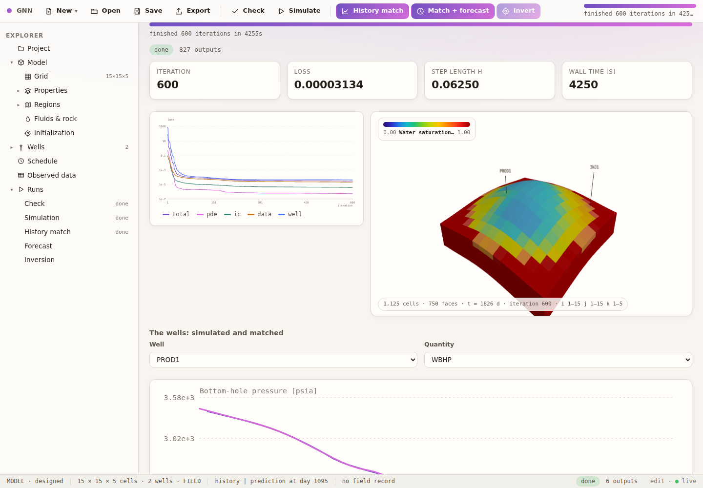

# gNN — a PERD workflow

Build a reservoir model, hand it to the simulator, and run it through a physics-informed neural network: match its whole history, match part of it and forecast the rest, or invert a field's well record for the properties nobody measured. gNN is a PERD app laid out like a desktop modelling package: a toolbar of project commands and jobs, an explorer of the model, tabs for each stage of the work.

The network is the composition the research campaign of `PINN-Lab` chose for every reservoir it was tried on (`AUTOPILOT`, [modules/autopilot.py](modules/autopilot.py)): a deep Galerkin network on Laplace-eigenfunction inputs of the reservoir's own grid, the black-oil balances enforced through a spectral residual, trained by energy natural-gradient descent. Nothing about it is a setting; each work path fixes only what the simulator's run is observed through and what closes the equations.



## The app

| Tab | What it is for |
|---|---|
| **Model** | A model is either **designed** in the app or **imported** as a deck. A design is edited section by section: the grid (columns, rows and layers; a structural top — flat, tilted, a dome or an anticline; faults drawn on a map, with their throw and transmissibility; inactive cells painted or boxed), property recipes (a constant, a value per layer, a trend, a correlated random field, a porosity–permeability transform, a scaled copy, a value in a box, in painted cells or in a region), fluids from correlations, rock–fluid functions, the initial equilibrium. An imported deck is edited keyword by keyword, with table editors for `EQUIL`, `SWOF`, `SGOF`, `PVDG` and the other tables; every file it does not change is written back byte for byte. The 3-D view shows the model as OPM Flow builds it. |
| **Wells & schedule** | The wells and their paths (vertical, deviated or horizontal, placed or drawn on a permeability map), the controls over time, the history \| prediction boundary, and the **observed record** — the field's measured bottom-hole pressures and rates, typed in, pasted from a spreadsheet, or imported from a CSV or an Eclipse summary. |
| **Simulation** | OPM Flow's findings about the deck, the simulated cell states in 3-D, every well's record, and the deck itself. |
| **History match** | Work path 1: the network learns the simulator's run of the whole history. |
| **Forecast** | Work path 2: the network learns the run up to the boundary and carries the field past it. |
| **Inversion** | Work path 3: the field record is inverted for the model's uncertain properties. |

The toolbar's jobs:

- **Check** — OPM Flow reads the deck tree and builds the model, then stops: its warnings and errors (with the file and line they concern), the grid with inactive cells and pore-volume cuts applied, the wells' perforations, and the static properties. Seconds, even for Norne.
- **Simulate** — OPM Flow runs the model; its report steps stream as it goes.
- **History match**, **Match + forecast**, **Invert** — the three work paths below.

Every job receives the whole project as one bundle, so the deck, the boundary, the field record and the prior always travel together, and a second job on the same model reuses the simulation, the extraction, the eigenbasis and the compiled steps.

## The three work paths

| | History match | Match + forecast | Inversion |
|---|---|---|---|
| learns from | the simulator's cell states at every report step and the wells' records | the same, up to the history \| prediction boundary | the cell states of 24 simulator runs of the model at sampled properties |
| well model | closed form; the well rows at weight 0.1 | predicted flowing pressure with control rows and the three-state switch (rate target, pressure limit, or shut) | closed form |
| closes the equations with | the observed states | phase equilibrium and whole-reservoir material balance where no state is observed | the observed states of every run |
| reports | the field and the wells against the simulator | the same, the forecast scored against the simulator's own run past the boundary | the posterior of each property, with the family's own error on 8 held-out runs added to the record's noise, verified by one more simulator run |

**What the inversion inverts** follows from the model: the vertical-to-horizontal permeability ratio always, the water–oil contact when the deck has water and the contact lies within the reservoir, the gas–oil contact likewise. The prior's widths are set on the Inversion tab. The runs and the trained family are kept, so inverting another record of the same model only searches again.

**What the methods can do** is what the research found: matched on cell states, the network reconstructs a reservoir closely; past the data, its physics carries depletion for about a year before the forecast drifts; from well records alone a field is not determined, which is why the inversion teaches a family of simulated reservoirs instead of fitting one.

## Building and publishing

Publish the repository from **Store › Publish from GitHub** as before. The image build runs [setup.sh](setup.sh) (ResInsight under a virtual display), then [requirements.txt](requirements.txt) (JAX with CUDA 12, OPM Flow as a wheel). The page needs **perd-worker 0.9** — the toolbar, tabs, data editors and maps it is built from arrived in that release — so publish once the platform's 0.9 release is out. The repository declares the **GPU T4** class in [perd.toml](perd.toml); give the build a 3600 s timeout and an 8-vCPU machine, and the workstation a three-day lease for field-scale models.

Cost on one T4, from the research campaign: a history match of a few thousand cells, minutes to an hour; of Norne (44,431 cells), about 36 hours for 600 iterations. A family for the inversion is 32 simulator runs (in parallel on the CPU cores) and one training of the network with property channels.

## Running it on this machine

```bash
python3.12 -m venv .venv
.venv/bin/pip install -r requirements.txt   # or jax[oneapi]==0.12.0.1 / plain jax for an Intel GPU / a CPU
.venv/bin/pip install 'perd-worker[page]>=0.9' perd-orchestrator
export RESINSIGHT_EXECUTABLE=/opt/ResInsight/bin/resinsight-xvfb   # a wrapper running ResInsight under xvfb-run
.venv/bin/python tools/local_app.py --port 8501
```

Then open <http://127.0.0.1:8501/>. [tools/local_app.py](tools/local_app.py) runs a worker, an orchestrator and the page in one process on loopback — the shape a workstation has, without the control plane. Models' work directories go to `$GNN_WORK` (default `/tmp/gnn`), one per deck tree.

## Tests

```bash
JAX_PLATFORMS=cpu .venv/bin/python -m pytest tests -q            # encoding, bundles, builder, deck round trips, names
RESINSIGHT_EXECUTABLE=… .venv/bin/python -m pytest tests -q -m slow   # every work path end to end on SPE1, with a test budget
```

[tests/parity](tests/parity) holds the developer scripts that prove the history-match and forecast paths train exactly as the research code (`pinnlab.config.autopilot`) does: identical losses at every iteration on SPE1.

## Layout

- `workflow.py` — the five operations; light imports only.
- `page.py`, `ui/` — the app: the shell, and one module per group of tabs.
- `builder/` — the model: the deck as a lossless document (`deck.py`), records and tables (`records.py`), designs and the decks generated from them (`design.py`, `correlations.py`, `units.py`), the project file (`project.py`), the deck variants of an inversion (`variants.py`).
- `modules/` — the numerics, extracted from `PINN-Lab`: `autopilot.py` (the composition and the three paths), `flows/` (check, simulate, and the three work paths as message streams), `frames.py` (the messages), the pipeline, the residuals, ENGD, the family; `simulate.py` (OPM Flow), `prep.py` (ResInsight).
- `templates/` — the sample decks offered under **New**.
- `field/` — the vendored deck-table parser.
- `setup.sh`, `requirements.txt`, `perd.toml` — the image recipe and what the workflow asks of the platform.

## License

See [LICENSE](LICENSE). The sample decks are OPM's, under the Open Database License.
